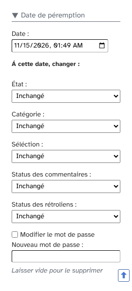
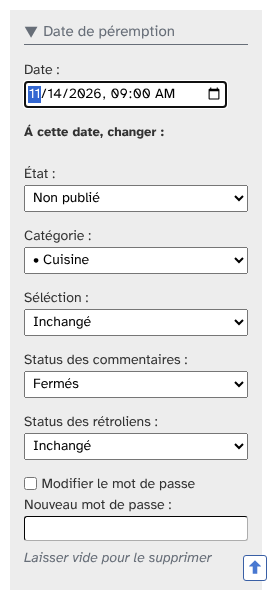
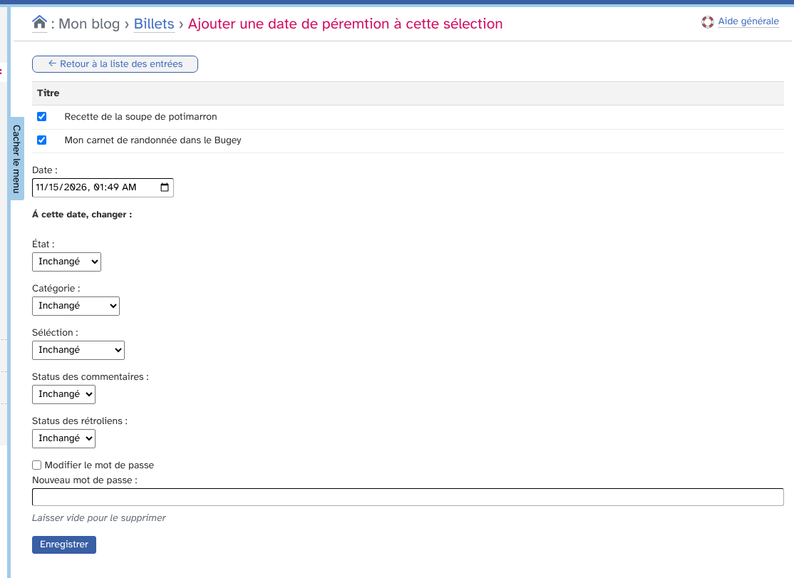

# postExpired : guide d'utilisation

postExpired permet de programmer, pour un billet ou une page, des changements à une date donnée : passer le billet en « non publié », le changer de catégorie, fermer les commentaires, lui mettre un mot de passe, etc.

## Table des matières

1. [Programmer un changement sur un billet](#programmer-un-changement-sur-un-billet)
2. [Programmer sur plusieurs billets](#programmer-sur-plusieurs-billets)
3. [Retirer une date de péremption](#retirer-une-date-de-péremption)
4. [Quand le changement a-t-il lieu ?](#quand-le-changement-a-t-il-lieu-)
5. [Bon à savoir](#bon-à-savoir)

## Programmer un changement sur un billet

Ouvrez un billet existant (ou une page). Dans la colonne de droite, une rubrique **Date de péremption** est repliée : cliquez dessus pour la déplier.

Remplissez :

* **Date** : le jour et l'heure du changement, dans votre fuseau horaire.
* **À cette date, changer** : les valeurs à modifier. « Inchangé » laisse la valeur actuelle.
  * **État** : publié, en attente ou non publié.
  * **Catégorie** : une catégorie, ou « Sans catégorie » (billets seulement).
  * **Sélection** : sélectionné ou non (billets seulement).
  * **Status des commentaires** et **des rétroliens** : ouverts ou fermés.
  * **Modifier le mot de passe** : cochez la case et saisissez le nouveau mot de passe. Laissé vide, le mot de passe du billet est supprimé.

Enregistrez le billet. La date et les changements sont mémorisés avec le billet : rouvrez-le pour les retrouver.

## Programmer sur plusieurs billets

Dans la liste des billets (ou des pages), cochez les billets, choisissez l'action **Ajouter une date de péremption** et validez. Une page vous demande la date et les changements, comme ci-dessus.

Les billets choisis reçoivent tous la même date et les mêmes changements.

## Retirer une date de péremption

* Sur un billet : videz la date, puis enregistrez. Ou laissez tous les changements sur « Inchangé » et enregistrez.
* Sur plusieurs billets : cochez-les et choisissez l'action **Retirer une date de péremption**.

## Quand le changement a-t-il lieu ?

Le plugin ne tourne pas en tâche de fond : la date est vérifiée quand un visiteur ouvre la **page d'accueil** ou un **flux** du blog. Une fois la date dépassée, les changements sont appliqués et la date de péremption est supprimée du billet.

Un billet n'a qu'une seule date de péremption.

## Bon à savoir

* La date n'est enregistrée que si au moins un changement est choisi. Si vous remplissez la date seule, rien n'est mémorisé et aucun message ne vous prévient.
* Tant que personne n'ouvre la page d'accueil ou un flux, le changement n'a pas lieu, même si la date est passée.
* La rubrique n'apparaît pas dans le formulaire de création d'un nouveau billet : enregistrez d'abord le billet.
* Le plugin fournit aussi des balises pour les thèmes (`EntryExpiredIf`, `EntryExpiredDate`, `EntryExpiredTime`) afin d'afficher la date de péremption sur le blog.
* Plusieurs textes de l'interface en français contiennent des fautes : « péremtion », « Séléction », « Status des commentaires », « Dtae de péremtion supprimé ».
